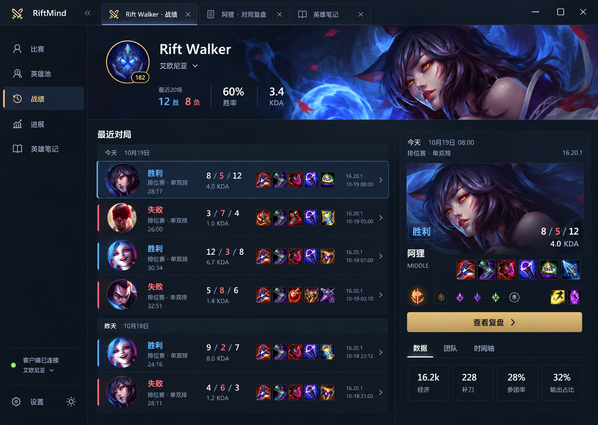

# RiftMind 界面设计规范

更新日期：2026-10-19。

本文记录已选定的整体重构方向：深色沉浸式游戏客户端，保留左侧菜单与顶部多标签。它是后续各业务页面的设计基准，不代表界面已完成实现。多主题属于设计与架构约束，本次不实现主题切换。

当前实现已覆盖统一外壳与业务页面，并接入玩家头像、等级、CommunityDragon 原画和皮肤目录。皮肤选择表示展示外观；头像和等级以实际客户端资料为准。实现检查见 [design-qa.md](design-qa.md)，Windows 原生验收仍待完成。

## 1. 设计基准

原图保存在 [design/immersive-client.png](design/immersive-client.png)。这是本次确认的最后一张概念图；原图中的示例数据、英雄选择、道具组合和文字细节不作为业务规则或数据来源。开发时使用真实资源和业务数据，不将整张图片切片作为界面。

整体观感是有游戏身份的个人桌面助手：深蓝底色、克制的金色操作、英雄原画与头像、清晰紧凑的对局列表。视觉重点集中在英雄内容、当前选中对局和主要操作上。

必须保留的产品结构：

- 左侧菜单负责业务功能导航，支持展开与折叠。
- 顶部多标签负责已打开的玩家、复盘和笔记等工作上下文，保留切换、关闭、排序及未保存保护能力。
- 原生窗口操作区保留最小化、最大化或还原、关闭及必要的拖动区域。
- 比赛、英雄池、战绩、进展、英雄笔记、设置使用同一套外壳与组件规则。

原图体现视觉方向；本文补充真实应用所需的交互、响应式、状态和多主题规则。具体业务逻辑以现有契约为准；与项目约束冲突时遵循 `AGENTS.md`。

## 2. 信息架构与布局

### 2.1 应用外壳

顶部从左至右为品牌与侧栏折叠入口、工作区标签、可拖动空白区域、Windows 窗口按钮。侧栏位于品牌区域下方；内容工作区位于标签区域下方。两条垂直边界始终对齐。

侧栏使用图标和标签，包含比赛、英雄池、战绩、进展、英雄笔记；设置、主题入口与客户端连接状态放在底部。选中项用低对比表面、主题强调色及位置标记共同表达，不依赖文字变色。折叠后保留图标、可访问名称和 Tooltip。

顶部标签代表工作上下文，不重复侧栏的业务导航。活动标签与内容区在视觉上连接；非活动标签弱化。长标签截断并可查看完整名称；标签关闭按钮与切换区域分开。标签过多时允许横向滚动，并提供已有的标签操作菜单，不能挤占窗口按钮和拖动区域。

### 2.2 战绩页

工作区分为上方玩家概览横幅，以及下方左侧对局列表和右侧选中对局详情。

| 区域 | 内容与层级 |
| --- | --- |
| 玩家概览 | 玩家身份、区服、头像与可用等级；最近若干场胜负、胜率和 KDA 为紧凑横排摘要 |
| 英雄横幅 | 右侧为英雄原画，左侧为信息安全区；图片使用渐变遮罩，保证文字可读 |
| 对局列表 | 按日期分组；每行包含英雄头像与名称、结果、模式与时长、KDA、装备、时间和详情入口 |
| 对局详情 | 对应选中行，展示英雄图、结果、基础数据、装备、符文、召唤师技能及查看复盘操作 |
| 详情内导航 | 数据、团队、时间轴按真实功能可用性展示，不添加尚不存在的空白功能入口 |

列表是一个有规律的整体，不将每场比赛做成重阴影大卡片。普通行以留白和轻分隔线区分；当前选中行叠加表面与轮廓强调。胜负提示与选中提示是不同状态，不能让所有胜利记录看起来都被选中。

点击对局行更新右侧详情，保留列表筛选、滚动位置与当前选择；点击“查看复盘”进入对应工作标签。必要的同步、玩家搜索、收藏、分页与筛选能力仍须保留，只需整理到紧凑且可发现的工具区或弹层中，不能因概念图未画出就删除。

右侧详情可在空间充足时随列表阅读保持可见，过高时随主内容滚动；默认使用一个主滚动容器，避免列表、详情和整页同时出现滚动条。

### 2.3 尺寸与对齐

以下为实现起点，属于建议设计值，不是对概念图的逐像素测量；应通过真实渲染复核。

| 项目 | 建议值或规则 |
| --- | --- |
| 基准视口 | 1440 × 1024 CSS 像素 |
| 标题栏 | 高 48px，窗口按钮保持稳定尺寸 |
| 侧栏 | 展开约 208px，折叠约 64px；品牌区与其共用宽度令牌 |
| 工作区间距 | 页面边距 24px，主要分区间距 24px，组内间距 8–16px |
| 玩家横幅 | 高约 200–224px；窄窗口主动缩短并调整裁切 |
| 列表与详情 | 宽窗口约 60:40；详情约 340–440px，列表获得剩余空间 |
| 对局行 | 高约 88–96px；头像约 48–56px，装备约 24–28px |
| 普通控件 | 默认高 36px，紧凑控件 32px，主要操作 40px |
| 基础间距 | 4、8、12、16、24、32px，避免逐页发明间距 |

列表列宽由同一个网格定义，英雄、胜负、KDA、装备与时间跨行对齐。数值使用等宽数字；名称左对齐，数值列按含义统一对齐。空数据也保留必要位置，不能让缺一件装备或缺少字段导致整行错位。

不要求在所有窗口强行保留双栏：空间不足时折叠侧栏、压缩次要元数据；继续缩小时将详情改为同一选择上下文中的 Drawer 或单栏详情。保留全部业务能力、返回路径和选中状态，避免页面级横向滚动。至少验证 1440×1024、1280×800、1024×768、800×600，以及 Windows 125% 和 150% 缩放。

## 3. 视觉语言

### 3.1 默认视觉方向

深蓝与金色是本次选定主题的表达，不是所有主题必须使用的颜色。基础层次为外壳、内容底色、交互表面、弹层；优先用明度和留白区分，再使用轻描边。金色用于主要操作、品牌和少量选中提示，不铺满卡片、标题和所有图标。

| 角色 | 当前主题参考色 | 用途 |
| --- | --- | --- |
| 深蓝背景 | `#101721` | 大面积底色与外壳基调 |
| 抬升表面 | `#182331` | 行选中、详情与弹层的层次起点 |
| 主要文字 | `#EDF1F6` | 正文、标题与关键数值 |
| 品牌与主操作 | `#C5A66A` | 金色按钮与少量强调 |
| 胜利 | `#7099D1` | 胜利标签和结果标记 |
| 失败 | `#D98D8D` | 失败标签和结果标记 |

以上是概念参考值，不是已通过对比度验收的完整色板。实现必须补齐文字配对、悬停、按下、禁用、边框与焦点色；金色按钮使用深色文字，禁止直接套用白字。警告、错误、连接状态有独立语义，不能因为颜色相近就复用品牌金或胜负色。

### 3.2 字体与形状

- 字体以 Windows 系统字体为主：Segoe UI Variable、Segoe UI、Microsoft YaHei，开发环境可使用 PingFang SC 回退。
- 正文与主要控件为 14–16px，辅助元数据约 12–13px，分区标题约 18–20px，玩家名称约 28–32px，KDA 与关键数值约 20–28px。
- 字重主要使用 400、500、600；以字号、字重和留白建立层级，不为每个数据加标题和徽章。
- 控件圆角约 8px，较大表面约 10–12px，头像按语义使用圆形或圆角矩形，装备小圆角。不同层级不机械复用一种圆角。
- 控制阴影、发光和渐变；横幅遮罩与主按钮可有轻微质感，其余区域保持安静。
- 普通控件使用现有 Lucide 图标，统一笔画与视觉尺寸。英雄、装备、技能和符文必须使用对应游戏图片。

### 3.3 图片与数据真实性

英雄图片预留固定尺寸和比例，原画裁切优先保留人物主体，不能拉伸。头像、装备和技能保持清晰，不能通过主题滤镜改变实体辨识。图片提供可访问名称；失败时有可识别的回退，但不能用回退替代正常图片。

横幅原画、玩家头像和等级仅在真实数据与资源可用时展示。概念图不能证明当前契约支持这些字段；不得为了还原图面编造玩家信息、段位或统计。没有横幅资源时保留完整身份区，以主题基础表面承接，不能出现巨大空白占位框。

## 4. 统一组件与交互

所有业务界面组合现有 shadcn/ui 组件；缺失组件通过官方 CLI 添加。统一组件规范后再覆盖各页，不通过页面选择器反复修补 Button、Select、Card 或 Tabs。

| 组件职责 | 统一规则 |
| --- | --- |
| 主操作 | 使用 Button 主变体，每个局部任务只突出一个主要操作 |
| 次要操作 | 使用 outline 或 ghost，保留清楚的悬停与焦点反馈 |
| 应用菜单 | 基于现有 shadcn/ui 组件组合；统一选中、折叠和 Tooltip 行为 |
| 工作标签与详情标签 | 共用状态规范，按不同层级定义尺寸与外观，不混淆两者职责 |
| 对局行与详情 | 提炼统一业务组件，处理实体图片、数值格式和缺失状态 |
| 筛选 | Select、Combobox、Popover 或 Dialog 等按任务组合，默认紧凑展示 |
| 表单与设置 | Label 与控件对齐，相关设置分组；校验就近展示，复杂说明按需展开 |
| 弹层 | Dialog、Drawer、DropdownMenu、Tooltip 共享主题、层级和焦点规则 |
| 图表 | 统一使用 ECharts，字体、轴线、图例、Tooltip 与语义颜色来自主题 |

相关控件必须覆盖默认、悬停、按下、焦点、选中、禁用、加载和错误状态。侧栏当前项、活动标签、选中对局、图表选中点采用一致的视觉层级，但不能共用一个颜色来混淆业务结果与交互状态。

保留键盘导航、可见焦点、图标按钮可访问名称与适当的点击区域。普通文本对比度目标至少 4.5:1，关键非文本控件与焦点边界至少 3:1；胜负同时使用文字和颜色。页面切换和主题切换不播放大面积装饰动画，并遵循减少动态效果偏好。

加载时保留布局并使用 Skeleton；真实空列表、筛选无结果、客户端未连接分别提供必要动作。局部资源或图表失败不遮挡整页，保留可用数据与重试入口。无技术术语、内部 ID、营销副标题或填空白的说明段落。

## 5. 多主题设计契约

### 5.1 主题与明暗模式独立

`themeId` 表示视觉主题，`colorModePreference` 表示 `light`、`dark` 或 `system`。系统设置只解析实际明暗模式，不自动替换主题。切换主题保留用户明暗偏好；切换明暗模式保留主题选择。

本次概念图定义沉浸主题的暗色视觉。浅色模式需要独立设计对应表面、文字、边框与横幅遮罩，不能简单反转颜色；本文尚未将浅色版本定义为已确认设计。正式提供的内置主题应完整支持明暗两套令牌，避免选择某主题时静默改变用户模式。

### 5.2 统一内容骨架与主题边界

| 全局统一，不随主题变化 | 允许主题定义 |
| --- | --- |
| 左侧导航、工作标签、窗口操作与业务路由 | 色板、表面层次、强调色、边框与阴影 |
| 信息层级、列表列定义、操作位置和阅读顺序 | 有边界的圆角与表面质感 |
| 控件高度、图片槽位、间距尺度、响应式规则 | 横幅遮罩、装饰纹理和品牌视觉变体 |
| 键盘、焦点、加载、错误、未保存保护等行为 | 同一语义角色对应的颜色与必要的图表配色 |
| 英雄与装备身份、业务数据和胜负含义 | 在可读性规则内调整字体表现，不改变字号与布局尺度 |

主题通过同一套组件表达不同视觉，不创建一套金色页面、一套浅色页面和一套其他主题页面。更换主题不能重排导航、删减数据、改变交互或令控件尺寸跳动。以后若需要紧凑密度，应作为独立能力设计，不借主题实现。

### 5.3 令牌分层

采用“基础值 → 语义 → 必要的组件映射”，沿用项目现有 CSS 变量命名，不另造并行的颜色系统。

1. **基础值**：具体颜色、间距、圆角等原始值。颜色原始值归属主题样式，通用尺寸归属布局基础。
2. **语义令牌**：说明颜色或样式的用途，是业务页面消费的稳定接口。
3. **组件令牌**：只有组件确实有独立职责时才增加，例如工作标签活动背景、横幅遮罩；默认引用语义令牌，不给每个按钮重复定义一组值。

| 语义范围 | 现有或拟补充的令牌 |
| --- | --- |
| 内容与表面 | `--background`、`--foreground`、`--card`、`--popover` |
| 应用外壳 | `--sidebar`、`--titlebar`；需要独立文字色时增加配对令牌 |
| 操作与交互 | `--primary`、`--primary-foreground`、`--secondary`、`--secondary-foreground`、`--accent`、`--accent-foreground` |
| 辅助与边界 | `--muted`、`--muted-foreground`、`--border`、`--input`、`--ring` |
| 反馈与结果 | `--destructive`、`--destructive-foreground`、`--warning`、`--warning-bg`、`--success`、`--win`、`--win-bg`、`--loss`、`--loss-bg`、`--remake`、`--remake-bg`、`--unknown`、`--unknown-bg` |
| 窗口与遮罩 | `--window-close`、`--window-close-foreground`、`--overlay`、`--shadow` |
| 需要补齐的状态 | 主操作悬停与按下、交互表面悬停与选中、禁用状态；语义名称按实际职责定义 |
| 横幅表现 | 信息安全区遮罩、原画边缘遮罩；避免页面硬编码“黑色渐变” |
| 图表 | 个人与对手、正负变化、坐标轴、网格、Tooltip 表面与文字的语义映射 |

`--destructive-foreground` 等未完整定义的配对令牌须在接入时补齐，不能把表格视为“当前已经实现全部变量”。品牌主色、胜负色、错误色和图表系列色职责独立；例如金色主题的个人趋势线不应被迫与金色主按钮同色。

所有主题与两种明暗模式提供同一份完整语义契约。业务组件中禁止原始颜色、Tailwind 固定色阶和按主题名称判断颜色的条件分支；shadcn/ui 通过现有 Tailwind 语义映射消费变量。主题切换应替换令牌值，而不是重写页面 CSS。主题标识只使用稳定业务名称，不以色号、阶段号或开发历史命名。

### 5.4 最小实现边界

先使用内置主题注册表与 CSS 变量，不引入外部主题下载、用户脚本、任意 CSS 注入或复杂插件系统。

- 注册表集中定义稳定主题 ID、显示名称、支持模式和样式入口；注册表定义不依赖业务页面。
- 继续由根节点 `data-theme` 与 `data-mode` 应用主题；主题样式限定在对应属性选择器内，防止全局规则串色。
- 全局默认值提供完整可用的回退。未知或已移除主题有确定的默认主题回退，不能显示未定义变量或白屏；回退不能清空其他用户设置。
- 设置仍通过现有设置服务保存与恢复，不额外建立另一套 localStorage 主题状态。
- 应用启动尽早应用已保存的主题与解析后的模式；读取期间采用明确回退，避免亮色闪屏。设置页预览或取消遵循现有保存语义。
- 主题切换只改变外观，保留打开标签、选中对局、筛选、滚动位置与未保存草稿，不刷新业务页面、不触发重复业务请求。
- Portal 中的弹窗、菜单、Tooltip 和原生窗口自绘区域同样消费主题变量；不能只有主内容变色。
- ECharts 不会自动继承全部 CSS。主题或模式变化后重新读取令牌并更新图表选项，保留缩放、筛选和证据选择等用户状态。
- 原画与主题解耦：同一英雄可以用于不同主题，仅由遮罩和承载表面适配明暗；不要为每个主题重复保存相同英雄资源。

### 5.5 现有实现与接入工作

以下为本次阅读源码确认的现状，不应误认为多主题已经可用：

| 位置 | 当前行为 | 后续需要 |
| --- | --- | --- |
| `src/generated/contracts.ts` | 已有 `themeId` 和 `colorModePreference` | 沿用 Rust 契约生成流程，不手改生成文件 |
| `src/app/theme/index.ts` | `applyTheme` 将非 `default` ID 回退为 `default` | 根据内置注册表解析合法主题和回退 |
| `crates/riftmind-core/src/settings/mod.rs` | 保存时将非 `default` 主题改回 `default` | 与前端统一支持列表及兼容策略，否则新主题无法持久化 |
| `src/styles/themes/default.css` | 提供默认主题明暗两套基础变量 | 补齐状态、图表和必要组件令牌，增加新主题样式 |
| `scripts/check.ts` | 只对默认主题明暗变量及部分对比度进行检查 | 遍历所有注册主题与模式，支持实际采用的变量解析方式 |
| `src/features/review/ReviewChart.tsx` | 读取部分 CSS 变量；只监听 `data-mode` | 同时响应 `data-theme`，补齐图表表面和系列语义；其他图表一并核查 |

切换主题涉及前端样式、应用入口、设置服务、图表和检查契约，不能只新增一个 CSS 文件。具体迁移与默认主题替换方式在实现时统一决定，保留旧设置可读取能力。

## 6. 各页面如何统一

- **比赛**：围绕当前比赛组织队伍与英雄阵容，使用相同头像、实体图标和数据列规范。
- **英雄池**：英雄图片是入口；列表或网格随任务选择，分布与趋势使用 ECharts，避免大筛选表单压住内容。
- **战绩**：以本图为主要视觉基准，落实玩家横幅、对局行和选中详情。
- **复盘与对比**：沿用英雄概况、关键数值、证据时间轴和图表的层级，不把所有指标铺成等权卡片。
- **进展**：突出训练目标、执行进度与可比趋势，详细解释按需查看，不增加装饰图表。
- **英雄笔记**：英雄身份、出装与训练内容保持图像化；编辑控件与未保存提示沿用统一规则。
- **设置**：同一外壳和主题下使用整齐的分组表单，不强行加入英雄横幅，也不单独变成另一套后台风格。

页面共用外壳、基础控件和业务展示规则，不要求所有页面都复制战绩页的双栏结构。主题不得成为新增重复业务组件的理由。

## 7. 重构与验收顺序

1. 固定应用外壳、尺寸和语义令牌契约，先统一侧栏、窗口栏与工作标签。
2. 统一基础 shadcn/ui 组件及所有交互状态，减少全局样式与局部覆盖互相抵消。
3. 以战绩页验证完整视觉闭环，再推广英雄展示、详情、表单与图表规则到其他页面。
4. 接入主题注册、设置保存、明暗模式、Portal 与图表更新，至少用第二套明显不同的主题验证没有硬编码依赖。
5. 在相同数据与视口下对照概念图，并逐页检查不同主题、明暗模式、语言、窗口尺寸和状态。

验收必须覆盖：

- 侧栏、品牌区、工作标签和内容边界对齐；长名称、空字段、装备不齐和大数值不破坏列表列对齐。
- 中英文本、长标签、多标签溢出、侧栏折叠及窗口缩放下可操作，无内容遮挡与页面横向溢出。
- 加载、空列表、未连接、错误、图片失败、图表失败以及未保存草稿均有一致且可理解的状态。
- 所有主题与明暗模式的正文、按钮、选中态、焦点、弹层和图表满足可读性要求。
- 切换主题、切换系统明暗偏好及重启后正确恢复外观；业务上下文和未保存内容不丢失。
- 新增主题主要增加注册信息和令牌，不修改业务页面条件分支；主题缺失时正常回退。
- 对 Windows 标题栏拖动、窗口控制和系统缩放进行原生验证，浏览器截图不能代替该验收。

本文件及配图记录设计方向和实施约束；新增主题、浅色设计与实际重构仍需按以上规则实现并验证。

## 8. 页面设计图索引

当前路由共有 8 个主要页面，已各保存一张设计图。全部沿用本规范的沉浸主题暗色状态、左侧菜单与顶部多标签；这些是不同业务页面的设计延展，不是不同主题。

| 页面 | 路由 | 设计图 | 本图重点 |
| --- | --- | --- | --- |
| 战绩 | `/matches` | [immersive-client.png](design/immersive-client.png) | 已确认的主视觉；对局列表与选中详情 |
| 比赛 | `/live` | [live-match.png](design/live-match.png) | 双方阵容、公开玩家概况与赛前速查 |
| 英雄池 | `/champions` | [champion-pool.png](design/champion-pool.png) | 英雄列表、场次分布与英雄相关入口 |
| 对局复盘 | `/matches/$matchKey/review` | [match-review.png](design/match-review.png) | 时间曲线、事件上下文、笔记与训练目标 |
| 两场对比 | `/compare` | [match-comparison.png](design/match-comparison.png) | 双局概况、时间对齐曲线与具体指标差值 |
| 进展 | `/progress` | [training-progress.png](design/training-progress.png) | 目标列表、固定基线、后续样本与训练趋势 |
| 英雄笔记 | `/notebooks` | [champion-notebook.png](design/champion-notebook.png) | 连招图片序列、笔记与手动练习 |
| 设置 | `/settings` | [settings.png](design/settings.png) | 分组设置、独立的主题与明暗模式选择 |

这批图片使用内置图像生成工具，以 `design/immersive-client.png` 为共同视觉参考，并结合现有页面职责生成。生成简报统一要求深蓝与金色、相同侧栏和工作标签、对应游戏实体图片、简洁内容、shadcn/ui 兼容控件和 ECharts 风格图表。截图内统计、文案、实体图标与曲线仅用于表达设计，实施时须核对真实契约、资源和计算，不从位图提取业务规则。

设置图中的“樱花”是未来主题入口的设计示例，不代表已实现，也不构成樱花主题完整的明暗视觉方案。图中的补充页面布局供后续评审与调整，不自动扩大已有功能范围；现有功能未画入首屏时仍应保留合适入口。
