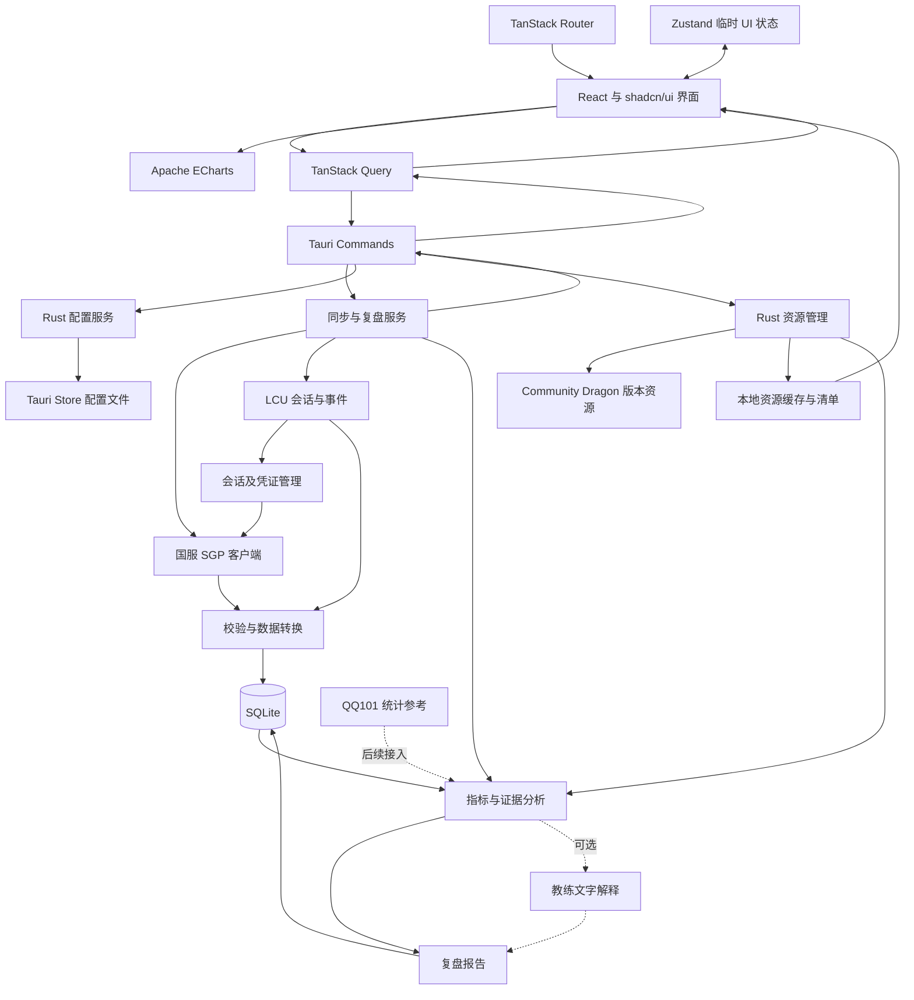

# RiftMind 架构设计

状态：v0.6 设计方案，2026-10-19。本文是后续实施基线；新增技术选型、插件和业务模块仍需按阶段接入，本文不代表功能已经实现。

一期交付以 [一期计划](../todo/stage1.md) 为准：完整基座、设置页和对局列表，包含国服/外服自动识别、i18n 和 Mac 可执行的测试链路。本文中的复盘详情、图表和训练闭环属于后续范围。

一期 UI 参考 Akari 的左侧功能区和顶部多标签；默认配色完整提供浅色/暗色与跟随系统。配色主题与明暗模式分离，粉色等额外主题属于未来扩展，一期不实现。

阅读顺序：产品边界与模块见第 1–3 节，数据源见第 4 节，运行时与存储见第 5 节，分析契约见第 6 节，IPC 与安全边界见第 7 节，交付和待验证决策见第 8 节。

## 1. 产品目标与已确定的约束

RiftMind 是 Windows 上的 LoL 教练复盘工具。核心流程是：连接已登录的客户端，自动识别国服或外服及具体区服，获取战绩和时间线，保存可离线查看的数据，再输出能够定位到具体事实的复盘建议。时间线和复盘能力在一期列表之后接入。

- 仅支持 Windows，沿用 Tauri 2 + Rust + React + TypeScript。
- 开发者使用 macOS：业务核心拆为不依赖 Tauri/Windows 的 Rust crate，Mac 运行真实 SQLite/模拟服务及浏览器测试；Windows 宿主通过独立 CI 验证，不增加 macOS 产品支持。
- **国服业务数据优先使用 SGP**。LCU 提供客户端会话、凭证、事件，以及能力有限的同区回退。
- SQLite 仅由 Rust 侧访问，沿用已引入的官方 `tauri-plugin-sql` 管理连接和迁移，数据库为 `sqlite:riftmind.db`。
- 前端采用 TanStack Router、Zustand、TanStack Query、Apache ECharts、Tailwind CSS 和 shadcn/ui；用户配置使用 Tauri Store Plugin 持久化。
- 一期采用 i18next + react-i18next，完整支持简体中文、英语和跟随系统；界面语言与客户端区服识别互不决定。
- 游戏美术与静态资源主要使用 Community Dragon，按对局版本解析、缓存并记录实际资源版本；历史复盘不隐式使用最新版语义数据。
- 本地单应用架构：一个 Rust 后端、一个 React 主窗口、一个数据库。
- 纳入类型化 IPC、日志诊断、后台任务及退出管理、资源管理、备份恢复、Windows 发布更新、分析质量基线和复盘反馈闭环。
- 首版建议围绕本人及选定玩家的赛后复盘，先支持召唤师峡谷单双排、灵活组排。其他模式可展示战绩，但需要独立分析规则。
- 教练能力先建立确定性的指标和证据，再接可选的大模型解释。大模型供应商及是否首版启用仍待产品确定。

这里的“复盘”首先指结算和时间线驱动的赛后分析。视频录制、ROFL 回放解析、逐帧操作还原及局内浮窗属于独立能力，不以 SGP DETAILS 能够提供这些内容为前提。首版没有云账号、跨设备同步和独立服务器；Riot 客户端登录身份用于数据访问，本地工作区归当前 Windows 用户所有。

## 2. 从 Akari 核实的事实

参考仓库：[LeagueAkari](https://github.com/LeagueAkari/LeagueAkari)，本次读取的源码提交为 `56cdfde00e56148f4641d1a8cf86acb66e903124`。

当前源码保留国服 SGP 地址、腾讯区服判断和国服数据样本。README 的支持声明与这些代码不完全一致；本项目按用户确认的国服支持目标及源码逻辑设计。源码与样本证明实现路径存在，不等于本次已经完成国服联网验证。

| 参考点 | 已核实的实现 | RiftMind 的使用方式 |
| --- | --- | --- |
| 国服服务配置 | `builtin.ts` 包含 `TENCENT_HN1`、`TENCENT_HN10` 和联合大区等配置，区分 `matchHistory`、`common` 地址 | 独立区服配置，禁止通过字符串规律猜测地址 |
| 两类凭证 | 战绩使用 entitlements 的 **accessToken**；召唤师、排位使用 league-session token | 请求按端点指定凭证类型，不能混用 |
| 战绩与时间线 | `SUMMARY` 返回结算与参与者数据，`DETAILS` 返回 frames、events 等时间线数据 | 分别获取、记录完整度和来源 |
| 跨区 | 国服有跨区查询路径；排位接口明确标注不能跨区 | 按端点维护能力，不能设置一个全局“支持跨区”布尔值 |
| 数据源选择 | 跨区强制 SGP；等待 token 与接口不可用是不同状态；同区可以回退 LCU | 把选择规则集中到 Rust 服务中 |
| 分析 | 先转换不同来源的数据，再计算单场和多场指标 | 复用分层思路，针对教练复盘重新定义规则与证据 |
| 国服统计 | QQ101 客户端提供版本、位置、段位、对局关系和构建等统计入口 | 后续作为外部统计参考，与玩家实际对局数据分开存储 |

源码链接见文末。借鉴数据接入、转换和分析方法；RiftMind 使用普通 Rust 模块组织，无需移植 Akari 的 Electron shard 框架。

## 3. 模块与数据流



| 模块 | 职责 | 输出边界 |
| --- | --- | --- |
| `clients/lcu` | Windows 客户端发现、本地 HTTP/WebSocket、初始快照与重连 | 会话状态、游戏状态、令牌及 LCU 原始响应 |
| `clients/sgp` | 国服/外服端点、区服解析、凭证注入、超时与响应解析 | SGP 原始响应及明确的错误类型 |
| `services/sync` | 数据源选择、去重、有限并发、重试、赛后补拉 | 持久化的对局及同步进度 |
| `domain` | 标准模型、来源转换、数据完整度、指标与规则 | 与网络和 UI 无关的可测试结果 |
| `storage` | 迁移、查询、事务、原始数据与报告版本 | 业务存储函数，统一数据库写入入口 |
| `services/review` | 组织分析、保存报告、可选调用大模型 | 事实、证据、建议与报告状态 |
| `services/jobs` | 任务调度、去重、取消、恢复与退出协调 | 持久化任务快照及进度事件 |
| `services/assets` | Community Dragon 版本解析、清单、下载与缓存 | 资源引用、实际版本与可用性 |
| `services/feedback` | 复盘笔记、建议反馈、训练目标与后续评估 | 用户记录和可追溯的进步指标 |
| `services/backup` | 数据备份、恢复校验、保留策略 | 备份清单及恢复结果 |
| `diagnostics` | 结构化日志、脱敏与诊断导出 | 可定位问题的本地诊断包 |
| React features | 战绩列表、复盘详情、趋势、连接与设置 | 调用业务 Commands，订阅状态变化 |

模块先按普通函数和结构体实现。每个数据源保留自己的请求及响应类型，只在转换边界形成共享领域模型。

依赖方向固定为 `commands → services → domain / storage / clients`：Commands 校验入参并调用用例，services 组织流程，domain 只处理值和确定性规则。domain 不依赖 Tauri、网络、SQL 或 React；clients 不直接落库，storage 不发网络请求。`app` 显式组装依赖，共享连接池和服务句柄；只在外部 I/O 边界引入必要的可替换接口，不建立通用插件框架或服务定位器。

### 3.1 技术选型

| 层次 | 选型 | 在本项目中的职责 |
| --- | --- | --- |
| 桌面宿主 | Tauri 2 + Rust | Windows 生命周期、IPC、原生能力与后台任务 |
| 视图 | React + TypeScript | 页面与类型化交互 |
| 路由 | TanStack Router | 类型化路由、路径参数、搜索参数、页面预加载 |
| UI 状态 | Zustand | 跨组件共享的临时交互状态 |
| 数据请求 | TanStack Query | 查询/变更 Rust Commands、异步状态、去重、内存缓存与失效刷新 |
| 图表 | Apache ECharts | 经济/经验/补刀曲线、事件标记、跨场趋势 |
| 样式 | Tailwind CSS | 布局、响应式样式、统一主题变量 |
| UI 组件 | shadcn/ui | 项目内维护的按钮、表单、弹窗、菜单等基础组件 |
| 国际化 | i18next + react-i18next | 简体中文/英语文案、错误翻译、语言切换；Store 保存语言偏好 |
| 业务存储 | SQLite，Rust 侧访问 | 战绩、时间线、证据、报告与同步任务 |
| 配置持久化 | Tauri Store Plugin | 主题、语言、窗口偏好、同步偏好等非敏感配置 |
| 游戏客户端交互 | Rust | LCU HTTP/WebSocket、凭证与 SGP 请求，国服 SGP 优先 |
| 游戏资源 | Community Dragon + Rust 资源服务 | 英雄、装备、符文、地图等资源，按版本缓存 |
| IPC 契约 | Rust 定义并生成 TypeScript 绑定 | Commands、DTO、事件及稳定错误码 |
| 日志 | Tauri Log Plugin | 本地日志输出、轮转，配合应用层结构化字段与脱敏 |
| 单实例 | Tauri Single Instance Plugin | 重复启动唤起现有窗口，避免重复后台服务 |
| 应用更新 | Tauri Updater Plugin | 发布前接入签名校验与安全重启流程 |

shadcn/ui 组件代码纳入 `components/ui`，按需添加；Tailwind 主题变量统一页面、组件和图表的配色。图表直接使用 Apache ECharts，不使用 shadcn 图表示例附带的另一套图表引擎。[shadcn/ui](https://ui.shadcn.com/docs)、[Tailwind 主题变量](https://tailwindcss.com/docs/theme)。

### 3.2 状态归属

| 状态 | 唯一权威来源 | 前端使用方式 |
| --- | --- | --- |
| 当前活动标签、页面、玩家、队列筛选、分页、选中的报告 | TanStack Router 路径及经过校验的 search 参数 | 从路由读取，导航时更新 |
| 打开标签、顺序、非活动视图位置与草稿 | Zustand 工作区状态 | 非活动路由快照用于恢复；安全标签元数据经 Rust 串行写入 Store，未保存草稿不持久化 |
| 弹窗开关、跨图表悬停时间、临时对比选择 | Zustand | 按功能拆小 store，组件使用 selector 订阅 |
| 单组件输入草稿、局部展开状态 | React 局部状态 | 留在所属组件 |
| 战绩、复盘、趋势 | Rust / SQLite | TanStack Query 缓存业务 DTO；不复制到 Zustand |
| 连接、同步任务进度 | Rust 会话与任务服务 | Query 保存可重新查询的快照，Tauri 事件驱动更新 |
| 配色主题 ID、明暗模式偏好、语言、侧栏折叠等 | Tauri Store | Rust 配置 Commands + Query 快照；实际 light/dark 由偏好和系统状态计算 |
| LCU/SGP 凭证 | Rust 内存 | 只暴露就绪状态 |

Zustand 不承担 API 请求缓存，不通过 `persist` 中间件另存配置副本。Query 缓存只驻留内存，离线数据从 SQLite 读取。可导航的筛选状态由 Router 管理；需要记住的默认偏好由 Store 提供初始值，不能覆盖当前路由的显式参数。[Zustand 官方说明](https://github.com/pmndrs/zustand)。

### 3.3 Router 与 Query 的协作

采用 TanStack Router 文件路由和 hash history，适配桌面静态资源入口。页面建议为 `/matches`、`/matches/$matchKey/review`、`/progress`、`/settings`；目标玩家、分路、队列、时间区间等参数需校验。深层路径刷新与历史导航纳入 Windows 打包验收。

整个主窗口共用一个 QueryClient，并注入 Router context。路由 loader 使用相同的 query options，通过 `ensureQueryData` 预取；设置 `defaultPreloadStaleTime: 0`，由 Query 管理数据新鲜度，避免另建路由级业务缓存。[Router 外部数据集成](https://tanstack.com/router/latest/docs/framework/react/guide/external-data-loading)。

查询链路为 `useQuery → commands.ts → invoke → Rust 查询 → SQLite`；同步、生成报告和保存配置使用 `useMutation`。SGP/LCU 的远程 HTTP 请求、限流和重试都留在 Rust。路由预加载仅预取本地数据，不能隐式触发全量同步或生成报告。

Query key 统一由功能模块生成，例如 `[workspaceEpoch, 'matches', playerKey, filters]`、`[workspaceEpoch, 'review', matchKey, playerKey, revision]`。玩家键含区服；筛选条件和报告修订进入 key。切号时取消旧会话相关查询，并切换对应 key，避免用旧账号数据占位显示新账号页面。`workspaceEpoch` 在恢复数据库后变化，避免旧库缓存混入新库。

本地 IPC 查询和提交本地任务的 mutation 配置 `networkMode: 'always'`，保证 WebView 判定离线时仍可读本地数据库、保存设置或提交由 Rust 判断网络状态的任务。初始使用 `retry: false`，远程重试由 Rust 统一处理；按业务事件精确失效，避免焦点变化触发额外远程同步。[Query 网络模式](https://tanstack.com/query/latest/docs/framework/react/guides/network-mode)。

Query 的 AbortSignal 不会自动取消已经发出的 Tauri invoke。需要真正停止后台任务时，使用明确的任务 ID 和取消 Command；Rust 仍负责 sessionEpoch 校验与任务去重。

多标签基座复用 Router 和 QueryClient，不为每个标签建立独立数据层。一期设置页单例，对局列表按含区服的玩家键唯一；不同标签可保留不同玩家的本地缓存，只有当前登录玩家可发起远端同步。切号激活新玩家标签，不改写旧标签身份。标签关闭只释放页面订阅，后台任务需显式取消。路由、侧栏和标签高亮通过同一解析器更新，完整规则见一期计划 4.0。

### 3.4 图表与样式

ECharts 按需注册折线、柱状图和所用组件。公共图表组件管理实例创建、数据更新、ResizeObserver 与卸载 dispose；复杂 option 构造放在对应 feature 内。图表实例留在 React ref，不放进 Zustand。[ECharts 按需引入](https://echarts.apache.org/handbook/en/basics/import/)、[容器与生命周期](https://echarts.apache.org/handbook/en/concepts/chart-size/)。

曲线使用 Rust 提供的指标、时间和完整度，缺失采样显示断点。证据点击定位到同一时间轴；共享悬停时间由复盘页的 Zustand store 管理，切换对局时重置。组件适配层把主题变量转换为 ECharts 颜色，主题切换时同步更新；tooltip、单位及数据表使用相同口径。

主题契约分为 `themeId`、`colorModePreference: light/dark/system` 与派生的 `resolvedColorMode`。一期仅有 default 配色的一对 light/dark tokens，未来粉色等主题通过同一语义 token 契约增加配色定义，不改变组件和业务逻辑。Store 保存选择，前端根节点统一应用主题选择器与 `color-scheme`，不另存 localStorage。模式切换保留标签、筛选、滚动、草稿及 Query 缓存，浮层与窗口外壳一起适配；语义胜负颜色不由品牌配色替代。

### 3.5 应用启动与可用状态

启动协调器属于 Rust `app`，顺序为 `单实例与日志 → 加载现有配置/识别数据版本 → 迁移前备份 → 配置和数据库迁移 → 本地服务 ready → 恢复任务 → 发现 LCU`。迁移前检查期间不启动同步，不创建业务写入；新安装没有历史文件时直接创建。

对外暴露 `booting / migrating / ready / recovery_required / shutting_down` 及失败原因。`ready` 表示本地工作区可用，不要求客户端已启动或 SGP 已联网。前端先显示应用外壳和启动状态，本地服务 ready 后再启用业务 Query；恢复模式只开放诊断、备份恢复和退出等允许操作，避免所有页面同时请求失败。

**SQL 插件的初始化必须受上述流程控制。** 官方插件在 preload 时会连接并执行迁移，不能等普通业务初始化完成后才备份。目标实现由启动协调器在检查与备份通过后注册/初始化 SQL 插件，再使用其 preload 和迁移；预检如需 SQLite 连接，只使用短生命周期的 SQLx 连接，完成后关闭，不形成第二个业务连接池。注册时机和错误恢复需要先做 Windows 小规模验证。[SQL 插件初始化源码](https://github.com/tauri-apps/plugins-workspace/blob/v2/plugins/sql/src/lib.rs)。

数据库和配置迁移分别记录进度；部分成功后重启必须能够继续或进入恢复模式。迁移不可逆时不能只恢复其中一个文件后宣称整体回退完成，恢复使用同一备份清单。

### 3.6 页面状态与交互边界

| 页面/组件 | 必须区分的状态和行为 |
| --- | --- |
| 应用外壳 | 启动中、迁移中、需要恢复；独立于 LCU 连接状态 |
| 连接区域 | 未发现客户端、等待登录、等待对应凭证、可用、连接中断；说明可执行的下一步 |
| 战绩列表 | 从未同步、同步中、本地有数据、同步失败但缓存可读、查询无结果、历史范围尚未加载 |
| 复盘详情 | 无结算、只有结算、时间线部分可用、生成中、报告可读、存在较新输入、生成失败 |
| 资源与图表 | 图片缺失使用占位；指标缺失显示原因，不显示成 0 或空白成功图表 |
| 编辑表单 | 未保存、保存中、保存成功、保存失败、版本冲突；失败保留输入草稿 |

路由负责可分享的本地定位参数，复盘链接保留玩家、对局、报告修订及选定证据；打开旧链接显示对应旧修订，数据已删除时明确提示。显示缓存时同时显示来源、最后同步时间和覆盖范围，不因联网失败清空缓存。

错误边界按路由及独立图表设置，单个图表异常不阻止阅读报告文字。图表提供数值表和键盘可达的证据入口，状态不能只靠颜色区分。界面文案集中管理，一期完整提供简体中文和英语，默认跟随系统：系统中文映射简体中文，其余回退英语，系统语言读取失败回退简体中文；用户可显式覆盖。时间存 UTC，显示按本地时区，比赛内时间统一为毫秒。资源语言、界面语言和客户端 locale 分别记录，详情见一期计划第 5 节。

## 4. 国服/外服 API 与游戏资源

### 4.1 端点清单

下列路径来自参考提交；域名由服务器配置提供，表中占位符仅用于说明。

| 用途 | 数据源与路径 | 凭证 / 说明 |
| --- | --- | --- |
| 当前玩家、游戏流程 | LCU 当前召唤师及 gameflow API | 本地 LCU Basic Auth；初始查询后监听事件 |
| entitlements 凭证 | LCU `/entitlements/v1/token` | 取响应的 `accessToken`，不是其中的 `token` 字段 |
| league-session 凭证 | LCU `/lol-league-session/v1/league-session-token` | 独立维护，监听更新 |
| 玩家战绩列表 | SGP `/match-history-query/v1/products/lol/player/{puuid}/SUMMARY` | entitlements access token；`startIndex`、`count`、`tag` |
| 单局结算 | SGP `/match-history-query/v1/products/lol/{regionPathParam}_{gameId}/SUMMARY` | entitlements access token |
| 单局时间线 | SGP `/match-history-query/v1/products/lol/{regionPathParam}_{gameId}/DETAILS` | entitlements access token |
| 批量召唤师资料 | SGP `/summoner-ledge/v1/regions/{regionPathParam}/summoners/puuids` | league-session token，POST 查询 |
| 排位资料 | SGP `/leagues-ledge/v2/rankedStats/puuid/{puuid}` | league-session token；首版仅同区 |
| 同区历史/结算回退 | LCU `/lol-match-history/v1/products/lol/{puuid}/matches`、`/lol-match-history/v1/games/{gameId}` | 参数及返回结构与 SGP 不同 |
| 同区时间线回退 | LCU `/lol-match-history/v1/game-timelines/{gameId}` | 转换为领域模型，不能假定与 SGP 字段等价 |
| 英雄统计参考 | QQ101 `https://mlol.qt.qq.com` 下的独立接口 | 后续接入；不是个人战绩来源 |

复盘数据的首选链路固定为 **SGP**，不提供让业务代码随意绕过该策略的入口。缓存用于即时展示与离线阅读，刷新时仍执行 SGP 优先策略。

### 4.2 区服和能力

独立配置 `serverId`、`region`、`rsoPlatformId`、`regionPathParam`、两个服务地址，以及各端点的同区/跨区能力。Akari 的 `TENCENT_HN1` 是应用内服务器标识，不能直接等同于远端路径、合区身份或所有响应里的 `platformId`。

首版使用随版本发布的已核实配置，并记录配置版本；后续若需要热更新，再加入受控来源、结构校验和最近可用版本回退。配置更新不能把携带令牌的请求导向任意主机。

能力状态至少区分 `supported`、`unsupported`、`unverified`。按“来源区服、目标区服、端点”判断跨区；先验证本人所在区，再验证跨区战绩。跨区排位默认不发请求。

### 4.2.1 自动识别国服与外服

Windows 发现器提供进程实例、显式 region/rsoPlatformId 等原始信息；core 解析已核实的启动参数并结合 LCU 会话核对，输出 realm、正式服/PBE 环境、规范 serverId、映射版本和识别状态。不能按系统语言、IP 或路径名称判断国服。多实例只选择一个，缺字段或证据冲突时保留 unknown/conflict，不猜端点。

国服继续 SGP 优先；外服有经过核实的对应 SGP 能力时使用该服务，否则只按规则允许同区 LCU 回退。国服、外服别名和各自 URL 通过显式配置映射；未知区服保持本地可读。界面中英切换不改变识别结果、登录身份和数据路由。一期只提供当前账号远端同步及本地缓存账号浏览，跨区查询策略做边界测试但不新增搜索页面。

### 4.3 数据源选择规则

| 情况 | 行为 |
| --- | --- |
| 同区，SGP 配置、端点、凭证均就绪 | 请求 SGP |
| SGP 所需 token 尚未到达 | 显示等待授权，等待 LCU 初始化/刷新；不因初始化稍慢立即改走 LCU |
| 同区 SGP 缺配置或确认不支持对应端点 | 对允许回退的查询使用 LCU，结果带回退原因 |
| 同区 SGP 超时或服务端故障，有限重试仍失败 | 展示已有缓存；允许的查询可获取 LCU 降级数据；后台保留 SGP 补全任务 |
| 跨区战绩 | 只使用已核实有该能力的 SGP 端点；不能回退当前区 LCU |
| SGP 401 | 从当前 LCU 会话刷新对应 token，重试一次；仍失败则等待重新授权 |
| SGP 403 | 返回权限/区服不匹配状态，不通过切换接口尝试绕过访问限制 |
| SGP 429 | 尊重 `Retry-After`，暂停该服务队列；不通过 LCU 制造额外重试流量 |
| 刚结束的对局 404/未出现 | 视为可能尚未入库，进行有限的延迟补拉；历史对局与新对局分开处理 |
| 客户端退出 | 停止远程刷新，已保存报告和战绩继续可读 |

Akari 使用两个 token 同时就绪的汇总状态。RiftMind 保留两种独立凭证，并按目标端点检查其所需 token；这是本项目的设计选择，不假定 Akari 已经采用同样策略。

LCU 回退响应不能覆盖已存在的、更完整的 SGP 数据。不同来源保留独立快照，选择或合并字段必须有明确规则；不存在的字段保存为缺失，不能填零。

### 4.4 Community Dragon 版本资源管理

Community Dragon 是游戏美术与静态资源的主要来源，覆盖英雄头像、装备、符文、技能、地图及展示所需静态描述。SGP/LCU 仍负责玩家实际对局数据，QQ101 负责外部统计参考，三者职责独立。

官方资源站提供版本目录；资源文档说明路径可能随版本调整，英雄资源应从对应 JSON 读取实际路径。前端只使用资源服务返回的引用，不自行拼接 CDN 地址。[版本目录](https://raw.communitydragon.org/)、[Community Dragon 资源文档源码](https://github.com/CommunityDragon/Docs/blob/master/assets.md)。用户提供的文档页面本次返回 404，因此使用同项目文档源码作为依据。

资源处理流程为 `原始 gameVersion → 版本映射 → 已存在的具体版本目录 → 资源 JSON → 实际文件路径 → 本地缓存`。

| 事项 | 设计规则 |
| --- | --- |
| 版本解析 | 保留原始 `gameVersion`，通过可校验的映射得到 `resolvedPatch`；记录映射版本与匹配状态。国服补丁、热修复和展示版本不能假定与资源目录一一对应 |
| 历史复盘 | 报告绑定具体资源清单及内容哈希。`latest` 只用于发现当前版本，不能作为持久化报告的版本标识；PBE 与正式服分开 |
| 资源清单 | 记录来源、具体版本、资源 ID、语言、路径、抓取时间和本地计算的内容哈希；版本目录不视为永不变化的快照 |
| 路径适配 | 按对应版本 JSON 和文档解析路径，集中处理路径转换及大小写；不靠英雄名称、皮肤编号猜文件名 |
| 语言 | 优先请求已确认存在的中文资源；缺失时回退同版本的默认资源并记录实际语言，不假设每个版本都有完整中文数据 |
| 美术缺失 | 优先本地缓存，失败时显示占位；如采用其他版本图片，应明确标记资源版本差异 |
| 分析数据缺失 | 不静默回退新版数值或规则。依赖缺失语义数据的指标标记不可用；不依赖它的结算指标继续计算 |
| 下载与展示 | Rust 按需下载、限制并发、合并相同请求；校验文件类型、大小及路径，临时文件完成后替换。WebView 仅获准读取资源缓存范围内的本地 URL，不通过 IPC 传大段图片内容 |

资源请求使用独立 HTTP 客户端和受控来源，不携带 LCU/SGP 凭证。资源站不可用时已有资源和复盘仍可离线展示；首次缺失资源不阻塞战绩入库。首版只下载当前页面及报告需要的资源，不镜像整个站点。

展示图片可以按容量和最近使用情况清理。参与分析的静态数据另存为可追溯输入，随报告保留；不能因为清理图片缓存而丢失报告依据。对局补丁、资源清单版本与分析规则版本分别记录，不共用一个 `version` 字段。

## 5. 会话、同步与持久化

### 5.1 客户端会话

连接过程为 `未发现客户端 → 连接 LCU → 等待登录 → 加载身份和令牌 → 可用`。WebSocket 中断后重连，重新获取关键快照，不能只依赖中断期间可能丢失的事件。

Windows 发现逻辑封装在 `clients/lcu/discovery.rs`，使用已核实的进程/安装路径和 lockfile 等信息；原生 API 优先，不依赖已被淘汰的 WMIC 可执行程序。完整实现路线在连接阶段根据 Windows 实测确定。

凭证只留在 Rust 内存。React 收到连接状态、当前玩家和能力状态；业务 DTO、SQLite 和日志不包含 auth token。LCU 与 SGP 使用独立 HTTP 客户端，本地 TLS 兼容处理不得影响远端 SGP 的证书校验。

每次账号或区服变化递增 `sessionEpoch`，取消旧会话请求。响应提交前检查 epoch 和所属玩家，避免切号后旧请求修改当前页面或当前账号同步游标。

同时发现多个客户端时只绑定一个经过选择的实例；候选绑定包含 PID、进程启动标识、端口和当前身份，不能只记 PID。端口、凭证或身份改变都触发会话重建。暂停/休眠恢复后重新核对客户端、令牌和快照，再恢复网络队列；WebSocket 重连使用有上限的退避，离开会话时清理监听和定时器。

登录身份 `sessionIdentity` 与被查询玩家 `targetPlayerKey` 分开：查询其他玩家不能切换当前登录身份。账号切换清理凭证、在途请求和会话缓存；本地已保存战绩仍可按玩家选择查看，不把登出等同于删除本地资料。多名 Riot 玩家共享同一 Windows 工作区，首版不提供玩家之间的本地访问隔离。

### 5.2 同步与统一后台任务

首次连接先拉最近一页战绩；列表已有结算信息时不重复逐局获取 SUMMARY。详情在打开复盘或后台补全时获取。监听赛后状态触发补拉，同时在启动/重连时对账，避免漏掉客户端关闭期间结束的对局。

首版建议每服务最多 2 个并发、单请求约 10 秒超时，暂态错误最多重试 2 次，带指数退避与抖动；这些是应用起始参数，需要国服实测调整，不是服务端公布的限制。新对局补拉可按 5、15、30、60 秒间隔进行，超出预算标记等待后续同步。

相同会话、目标区服、查询参数的在途请求合并。详情任务按稳定对局键去重；重复事件、重连和手动刷新不得制造重复对局。任务记录重试时间和阶段，进程重启后可恢复未完成工作。

同步、报告生成和资源预取共用 Rust 任务调度，不引入独立消息队列服务。任务记录 `taskId`、类别、业务对象、输入修订、阶段、进度、重试预算和取消状态；同步类任务还绑定账号、目标区服和会话。按类别设并发额度，避免批量资源下载挤占当前复盘请求。

任务状态为 `queued → running → succeeded/failed/cancelled`，暂态失败进入 `waiting_retry`；异常退出留下的运行任务启动后转为 `interrupted`，检查输入修订、会话和检查点后再决定恢复。确定性计算与幂等下载可重跑；外部模型调用结果不明时不盲目重复可能收费的请求。

长任务 Command 返回任务 ID，进度通过快照查询与事件展示。取消在安全检查点生效，已提交的数据保留；取消请求不能宣称回滚已完成的工作。任务阶段和业务写入尽量在同一短事务内提交，事件在提交成功后发送。

会话凭证等待与网络重试分开，等待凭证不消耗 HTTP 重试预算。401 刷新按会话和凭证类别合并为一次在途刷新，其他请求等待结果；429 冷却覆盖同一目标服务的所有任务。解析失败标记协议不兼容，不作为暂态网络错误无限重试，也不提升数据完整度。

任务先持久化再返回 ID；活动任务按业务幂等键去重，幂等键不含随机 request ID。报告键包含对局、玩家、输入指纹和规则版本；新输入形成新任务。恢复是“可能重跑 + 幂等写入”，不承诺只执行一次。任务领取与状态转换通过条件更新完成，旧执行者只能提交自己仍持有的运行代次；进程重启不能复用旧 `sessionEpoch` 直接发送请求。

### 5.2.1 单实例、托盘与退出

采用官方 Single Instance 插件，在启动数据库和后台连接前取得单实例控制；重复启动只唤起现有窗口。关闭窗口默认最小化到托盘，可在 Store 中改为退出；托盘不可用时不能隐藏成无法找回的进程。[Single Instance 文档](https://v2.tauri.app/plugin/single-instance/)。

“退出应用”、安装更新、恢复备份共用生命周期协调器：停止接收新任务，取消或暂停网络请求，等待短事务到达安全点，保存任务检查点和 Store，再关闭连接。创建备份只暂停写入，保留生成快照所需连接。等待超时不伪造任务成功；下次启动按中断恢复。隐藏窗口继续同步，真正退出不继续运行后台任务。

### 5.3 标识与完整度

- 玩家：使用内部 ID，外部唯一键至少包含区服和 PUUID。游戏昵称只是可变展示字段。
- 对局：保存服务返回的完整 match ID、平台标识和 game ID；建立经过校验的规范键。不能仅按数字 game ID 去重，更不能用当前登录区替换目标对局的区服。
- Rust 内部保留正确整数类型，跨 IPC 的外部 ID 使用字符串，避免 JavaScript 大整数精度丢失。
- 所有响应标记 `source`、`targetServerId`、`fetchedAt`、`schemaVersion` 和内容哈希。
- 完整度分别记录 summary、timeline 的 `missing/pending/partial/ready/unsupported/failed`，另列可用字段能力。拿到 DETAILS 响应不自动等于时间线完整。
- 校验 summary 与 timeline 的 game ID、参与者映射和合理时间范围；未知新增事件保留原始值，不使整场解析失败。

### 5.4 SQLite 模型

以下是分阶段落地的逻辑模型，正式迁移在实现阶段补齐字段、外键和索引。核心战绩与任务表先落地，资源及训练闭环表随对应功能加入；用户配置单独使用 Tauri Store。

| 表 | 主要内容与约束 |
| --- | --- |
| `players` | 内部 ID、区服、PUUID、最近昵称、资料；区服 + PUUID 唯一 |
| `matches` | 规范对局键、原始 match ID、平台、game ID、版本、模式、开始时间、时长、完整度、当前数据修订号 |
| `match_participants` | 对局 ID + participant ID 唯一；玩家身份、队伍、英雄、位置、可查询的核心结算指标 |
| `match_revisions` | 对局 + 修订唯一；固定的 summary/timeline 快照集合、字段来源、转换器版本、标准数据及能力集合，追加保存 |
| `source_snapshots` | 对局/玩家引用、来源、端点类别、抓取时间、内容哈希、原始 JSON；同一对象/来源/类别/哈希去重 |
| `reference_snapshots` | QQ101 等统计参考的补丁/模式/分路/段位范围、抓取时间、内容哈希和数据；报告按引用固定，不随最新统计覆盖 |
| `reviews` | 对局、目标玩家、输入快照及资源清单引用、指标、证据、建议、规则版本、可选模型/提示词版本和生成状态 |
| `jobs` | 同步/报告/资源任务类别、账号/目标区服、对象键、输入修订、游标、阶段、次数、下次运行时间和错误码；限制重复活动任务 |
| `sync_state` | 玩家 + 目标区服 + 查询范围唯一；最近对账时间、已覆盖范围、头部边界及历史补拉检查点，不存 token |
| `resource_manifests` | 请求版本、实际补丁、映射版本、匹配状态、资源路径/语言/哈希及分析所需静态数据引用；图片文件留在缓存目录 |
| `review_notes` | 玩家、对局/报告修订、可选证据引用、笔记内容及更新时间；报告重算不覆盖用户笔记 |
| `review_feedback` | 报告修订、finding ID、是否有帮助/不准确等反馈及原因 |
| `training_goals` | 玩家、目标指标及口径、适用模式/位置/版本、基线、阈值、起止时间和状态 |
| `goal_evaluations` | 目标、评估窗口、所用对局及报告修订、样本数、指标结果和可比性说明 |

时间线首版以 JSON 快照保存，不把全部 frame/event 展开成独立表；常用筛选字段结构化，查询性能有实测需求后再加索引表。

一次成功入库在短事务中更新快照引用、规范数据和任务阶段。数据库写事务内不等待网络。报告引用具体输入修订；后续 SGP 补全后产生新的分析修订，已有报告可显示“有新数据可重算”。

官方 SQL 插件在启动检查通过后负责数据库预加载及迁移，时序见 3.5。目标结构由 Rust `storage` 使用插件管理的 SQLite 连接池执行业务事务；采用 SQLx 时必须对齐插件实际使用的版本，并通过 Cargo 锁文件固定。SQL 插件公开的 `DbInstances` / `DbPool` 是这条接入路线的基础，具体 API 在实现时核对安装版本。

为支持 Mac 测试，存储用例位于独立 core crate，接收宿主注入的 SQLx SqlitePool；生产宿主复用插件池，测试由临时 SQLite 池执行同一迁移和存储代码。core 不依赖 SQL 插件或 Tauri，配置持久化也通过适配边界连接生产 Store 与测试文件存储。

当前 `src/lib/database.ts` 和前端 SQL 权限是已完成的基础接入。进入业务实现阶段后，先迁移数据库调用到 Rust Commands，再移除前端通用 SQL 入口与权限，避免组件和后台同步各自维护业务写入规则。迁移前后都使用同一数据库，不新建平行数据库层。

### 5.5 配置持久化：Tauri Store Plugin

通过官方 Store 插件保存 `settings.json`。Rust `settings` 模块负责加载、默认值、schemaVersion 迁移、字段校验与保存；前端统一通过 `get_settings` / `update_settings` 访问，Query 只保存返回的配置快照。Store 插件支持 Rust 侧文件持久化。[官方文档](https://v2.tauri.app/plugin/store/)。

配置包括主题、语言、窗口偏好、默认筛选、最近选择的玩家和自动同步偏好。战绩、报告及同步游标留在 SQLite；token 留在 Rust 内存；后续模型密钥使用 Windows 凭据存储。

启动先加载并校验配置，再应用主题和启动相关后台任务。更新通过单一 Rust 写入入口串行处理，显式保存成功后再返回成功、更新 Query 配置快照并通知订阅者；保存失败返回错误，恢复旧配置，避免内存与磁盘状态分歧。损坏文件保留备份并反馈恢复状态，不静默覆盖。

SQLite 与 Store 没有跨存储事务。业务正确性不能依赖二者同时提交：对局入库与同步游标在同一个 SQLite 事务内完成；Store 的“最近玩家”等偏好独立保存。首版不建立 SQLite `settings` 表。

### 5.6 备份、恢复与数据保留

业务数据库沿用现有应用配置目录，配置文件与数据库分别管理；可重新下载的美术使用应用缓存目录，日志使用日志目录。设置页展示各类占用和清理影响，区分用户笔记/训练目标、报告、原始快照与可丢弃图片。

备份通过 Rust 服务建立一致 SQLite 快照，优先评估当前连接层可用的 `VACUUM INTO`，不直接复制正在写入的单个 `.db` 文件。SQLite 官方同时提供 Online Backup API 作为备份方式。[SQLite 备份文档](https://sqlite.org/backup.html)。

完整备份短暂暂停业务写入和配置更新，等待在途写入结束，保存 Store 后分别生成数据库、配置及报告所依赖的静态数据快照。备份清单记录备份 ID、应用/数据库/配置版本、文件哈希和创建时间；全部成功才标记完整，不宣称 SQLite 与 Store 具备跨文件事务。凭证及模型密钥不进入备份，可下载图片默认不打包。

恢复先在临时目录校验文件大小、路径范围、哈希、数据库完整性和 schema 兼容性；检查成功后再进入维护状态，关闭连接、保留当前数据备份并替换，重启存储服务。恢复失败保留旧数据，不能边导入边覆盖正在使用的库。首版完整恢复采用替换语义，跨备份合并另行设计。

用户笔记、反馈和训练目标不自动清理。报告引用的原始快照与语义输入受保留约束，清理前检查引用；若用户明确删除整组复盘，提示其证据和重算能力的影响。图片缓存独立清理；已保存的历史报告不会因后台规则升级自动覆盖。

### 5.7 数据修订与并发一致性

`matches` 和 `match_participants` 是当前查询投影；`match_revisions` 是不可变分析输入，保存所选快照、转换版本及当时的标准数据。相同规范内容不增加修订；转换器升级也必须生成可区分的新修订。原始快照缺字段时不能用另一个来源的同名字段直接补齐，混合来源必须通过版本化的合并规则并保留字段来源；无法确认等价时保留分离视图。

一次入库短事务完成 `原始快照去重 → 新修订 → 当前投影 → 同步检查点/任务阶段`，成功后才通知前端。质量选择先看字段能力和完整度，再看来源优先级，不能只用抓取时间决定覆盖。并发补全按预期修订做条件更新，冲突时重新选择输入，不让晚到的旧响应覆盖新投影。

报告输入指纹至少包含 `matchRevision + targetPlayerKey + normalizerVersion + ruleSetVersion + semanticResourceHashes + referenceSnapshotIds`；可选模型表达另加模型、提示词和输出 schema 版本。纯图片变化不触发指标重算。生成时固定输入，提交时即使当前对局已更新，也只保存为原输入的报告；不能将它误标为当前报告。用户笔记、配置编辑使用 `expectedRevision` 防止旧表单覆盖新状态，冲突返回当前修订并保留草稿。

### 5.8 同步覆盖范围与分页

同步分为最近对账、用户请求的历史补拉和单局详情补全。首次默认只取一页；历史补拉必须有页数、时间范围或对局数预算，并支持取消。首版初始值建议本地列表每页 50、上限 100；远端 page size 单独按已验证能力配置，不能把本地上限当成 SGP 限制。

SGP 的 `startIndex` 是偏移，不是稳定快照游标。新对局会移动页边界：每页按对局键去重，重启或中断恢复先重读头部并重叠检查已保存边界；找不到边界时从头在预算内重新对账，保留范围尚未完整的状态。入库成功才推进检查点；失败、取消、接口历史窗口限制不得被显示成“全部历史已同步”。历史列表持续变化时不承诺无遗漏，后续对账继续补齐。

界面区分“已保存数量”“本次新增数量”“已覆盖日期范围”和“仍可能有更早记录”。详情补全失败不回退已成功的列表检查点；为缺失详情保留独立任务。QQ101 和玩家当前排位等可变参考带抓取时间与新鲜度；它们不是该历史对局发生时的排位或统计。

本地列表按 `startedAt DESC, matchKey DESC` 稳定排序，使用包含筛选条件和读取边界的游标；同步期间新增数据通过刷新回到列表头部，不把新记录插入正在翻页的集合。时间线按请求窗口/事件类别分段读取，返回同一个 `matchRevision`，不能将不同修订的片段拼成一场复盘。

### 5.9 SQLite 运行策略与维护

本地数据库目标使用 WAL、显式外键约束和有上限的 busy timeout；每个池连接都核对连接级配置。WAL 仍然只有一个写入者，不通过扩大连接池制造写并发；业务写入在应用侧有界排队，读取用短事务。实施时先验证官方插件连接池的配置入口，不能只在任意一个连接执行 PRAGMA 后假定整个池一致。[SQLite WAL](https://www.sqlite.org/wal.html)、[外键配置](https://www.sqlite.org/foreignkeys.html)。

初始索引围绕真实查询：玩家战绩关联、对局时间与队列筛选、快照去重、对局修订、报告输入指纹及到期任务。写入唯一键、外键和活动任务约束由数据库兜底。磁盘满、只读目录、损坏或长期锁占用分别返回稳定错误；暂停写任务，保留可读数据，不反复重建数据库。

监控数据库和 WAL 大小，空闲期执行受控检查点，避免长期持有读事务；压缩和大批删除作为维护任务，不在打开复盘时阻塞执行。数据库不放在网络共享或同步盘上运行；导出的备份可以另行存放。恢复或导入后重新生成本地缓存命名空间 `workspaceEpoch`，使旧 Query 缓存、游标和事件全部失效。

## 6. 教练复盘如何形成

分析链路：`原始快照 → 标准对局 → 指标 → 带证据的观察 → 改进建议 → 报告`。

### 6.1 首版指标和边界

| 维度 | 所需数据 | 可输出内容 |
| --- | --- | --- |
| 对局表现 | SUMMARY | KDA、CS/min、伤害与经济占比、参团率；明确计算口径 |
| 对线发育 | 时间线参与者帧及可靠的位置匹配 | 10/15 分钟补刀、经济、经验，以及同位置对位差 |
| 死亡复盘 | 击杀事件、时间和参与者 | 死亡时间线、参与击杀者、是否有敌方打野参与；可用时展示伤害构成 |
| 资源事件 | 龙、先锋、防御塔等事件 | 资源前后可观察到的经济和死亡变化，描述事件顺序 |
| 构建过程 | 装备购买/出售/撤销、技能升级事件 | 实际出装顺序、加点与关键成装时间 |
| 长期改进 | 同玩家、模式、分路及可比版本的多场数据 | 趋势、重复出现的观察、下一阶段训练目标 |

指标计算固定单位和分母：CS 区分线上与野区；时长使用实际比赛时长；参团率分母为己方英雄击杀数，分母为零时记录不适用。位置匹配不确定时不产生对位差；10/15 分钟未到达或缺少合适采样帧时不补造数值。

时间线采样无法完整还原玩家视野、兵线和操作意图。可以说“某次死亡有敌方打野参与”，不能仅凭这一条事件断言“没有看小地图”；可以标出“死亡后出现资源丢失”，不能直接断言死亡导致丢失。低完整度数据只生成其能够支持的分析。

QQ101 后续补充有明确版本、分路、段位和模式口径的统计参考。不把英雄胜率当成个人复盘分数；没有相应样本的指标不生成“超过同段位百分之多少”结论。无法匹配历史版本时明确标记参考版本差异。

### 6.2 证据与报告契约

每条观察保存：`findingId`、规则 ID/版本、所需数据能力、实际指标、证据引用和限制说明。证据定位到 `snapshotId + JSON 路径/事件索引 + timestampMs`，前端可从建议跳转到时间线。

报告按目标玩家生成，包含本场概况、值得保持的表现、最多三项优先改进、对应时间点、下一局可执行目标，以及数据缺失说明。避免用单一总分代替复盘。

大模型作为可选的表达与总结步骤：输入结构化事实和证据 ID，输出经过结构校验的建议；引用必须存在，数字必须来自指标。模型故障或未配置时仍可展示确定性报告。使用外部模型时，由用户主动开启，只发送复盘所需内容；调用路径、费用与模型选择在接入阶段确定。

### 6.3 复盘反馈与训练闭环

流程为 `查看证据 → 标记建议是否有帮助/不准确 → 补充笔记 → 选择训练目标 → 后续对局评估`。反馈绑定报告修订和 finding ID，笔记可绑定对局或证据；新报告生成后保留旧反馈，不把旧意见自动附到含义不同的新建议上。

训练目标由用户确认采用，保存指标定义、基线、阈值、适用队列/位置/版本和评估窗口。例如提高同位置排位的 10 分钟补刀，必须只使用达到该时长且数据完整的对局。评估同时展示样本数和缺失原因；模式或版本变化影响可比性时分组展示。指标改善代表观察到的变化，不能直接认定是某条建议造成的。

笔记、反馈和目标属于 SQLite 业务数据，经 Commands 写入并由 Query 刷新；不能仅存 Zustand 或 Store。首版提供本地记录与规则评估，不自动上传用户反馈或将其用作模型训练数据。

### 6.4 分析质量基线

建立脱敏的固定对局样本集，覆盖国服 SGP、LCU 回退、不同补丁、缺失时间线、未知事件、装备撤销、提前结束、重复事件和不同位置。每份样本保存来源说明、输入哈希、资源清单、规则版本，以及人工核对的关键指标和证据位置。

规则变更必须比较同一输入下的指标、观察和证据差异；确定性指标和引用校验全部通过后，才接受新的预期结果。禁止用当前实现自动生成结果并未经核对就作为正确答案。数据源转换测试与分析测试分开，避免转换错误被后续算法掩盖。

如接入大模型，追加结构、数字、引用和不支持结论的检查，保留模型/提示词版本；文字表达采用固定案例人工抽查，不要求措辞逐字一致，也不把语言流畅当作质量通过。规则升级产生新报告修订，允许对比旧版。

### 6.5 领域模型与规则执行契约

| 模型 | 必须表达的内容 |
| --- | --- |
| `MatchContext` | 对局/玩家键、queue/map/mode、原始版本、修订、时长、参与者映射与数据来源 |
| `DataCapabilities` | 结算、参与者帧、位置、击杀/装备事件等具体能力，以及缺失原因；由内容校验得出 |
| `MetricResult` | 指标 ID/版本、单位、值或空值、适用范围、采样时间及 `available/missing/not_applicable/unsupported` 状态 |
| `EvidenceRef` | 不可变快照 ID、JSON 路径或原始事件索引、比赛内时间；可验证属于同一输入 |
| `Finding` | 规则 ID/版本、指标引用、证据、观察文字、局限、建议优先级；不将经验判断写成确定事实 |
| `ReviewReport` | 固定输入指纹、目标玩家、指标/观察、资源与参考引用、规则版本、可选模型表达状态 |

每条规则声明支持的模式、补丁范围和所需能力，然后执行 `supports → compute → validate → explain`。某条规则数据不足只跳过该规则，并返回原因；基础输入损坏则拒绝整场分析。规则以 Rust 普通模块和显式注册表组织，首版不加载外部脚本。

指标不返回 NaN/Infinity；缺失值不以 0 替代，内部保留计算精度、展示层按单位舍入。事件按时间及稳定的原始索引排序，证据保留原位置；不能仅以“同毫秒、同类型”删除可能真实发生的两次事件。坐标仅在地图及坐标系已校验时用于图示，不把静态地图图片视为玩家视野信息。

### 6.6 可选模型接入边界

模型由 Rust `services/review` 通过单一供应商适配边界调用：输入是确定性事实、允许引用的 ID 和语言；输出是受限结构的解释。密钥由 Rust 读取 Windows 凭据存储，前端仅获取配置是否可用。用户昵称、笔记和接口文本都作为数据处理，不允许其中的指令改变系统约束；模型没有 SQL、文件操作或 LCU 调用权限。

确定性报告先独立提交，模型解释作为附加修订保存；模型超时、拒绝、输出校验失败或用户取消，均不阻止阅读事实报告。限制输入长度、输出长度、请求时间和单次调用预算，记录实际可获得的用量；自动重试遵守任务层的收费调用规则。结构和数字校验无法保证所有文字推论正确，未经支持的解释不作为确定性结论展示。

## 7. 前后端契约与目录

### 7.1 类型化 IPC

Rust 是 Commands 参数、结果 DTO、事件 payload 与错误类型的唯一契约来源，生成 TypeScript 类型及调用绑定，前端不手写第二套同名定义。生成工具在实现时验证 Tauri 2 和当前 Rust 类型的兼容性，选型后固定版本；CI 重新生成并检查产物差异。外部 SGP/LCU JSON 仍需运行时校验，类型生成不能代替边界校验。

错误结构统一为 `code`、`message`、`retryable`、`source`、`requestId` 和经过筛选的上下文，长任务另带 `taskId`。区分未连接、等待凭证、能力不支持、限流、资源缺失、数据不完整与内部错误，前端按 code 决定提示和操作。每个 invoke 生成关联 ID，贯穿任务和日志；内部错误详情不直接显示给用户。

### 7.2 Commands 与事件

首批及后续阶段的 Commands 边界如下，按功能阶段加入：

| Command | 作用 |
| --- | --- |
| `get_app_state` | 返回启动/恢复状态、workspaceEpoch 和本地服务可用性 |
| `get_connection_state` | 获取当前会话及 SGP 能力摘要 |
| `list_players` / `lookup_player` | 读取本地玩家；按明确区服与当前能力查找远端玩家，返回规范玩家键 |
| `sync_player_matches` | 发起指定玩家同步，返回任务 ID |
| `list_matches` | 按玩家、模式、时间分页读取本地战绩 |
| `get_match_review_data` | 返回结算、所需时间线片段、来源及完整度 |
| `get_timeline_slice` | 按固定对局修订、时间范围与事件类别读取有界片段 |
| `generate_review` | 为指定对局/玩家/数据修订提交生成任务，返回任务 ID |
| `get_review` | 读取报告和证据 |
| `cancel_task` | 请求取消可取消的后台任务 |
| `get_task_status` | 获取任务进度快照，用于重载后恢复和事件对账 |
| `get_settings` | 读取校验后的 Tauri Store 配置 |
| `update_settings` | 校验、保存配置并返回新快照 |
| `resolve_assets` | 按对局版本和资源 ID 返回本地资源引用、版本及可用性；缺失时排队下载 |
| `save_review_note` / `save_review_feedback` | 保存笔记、建议反馈及所属报告修订 |
| `get_review_annotations` | 读取指定对局/报告的笔记和反馈 |
| `save_training_goal` / `get_goal_progress` | 设置训练目标、查询基线及后续评估 |
| `list_training_goals` | 按玩家和目标状态分页读取训练目标 |
| `create_backup` / `restore_backup` | 创建备份；按维护流程校验并恢复用户选定备份 |
| `get_storage_usage` / `clear_asset_cache` | 查询占用，清理可重新下载的美术缓存 |
| `export_diagnostics` | 生成脱敏诊断包，返回保存结果 |

事件仅推送 `app-state-changed`、`connection-changed`、`task-progress`、`match-updated`、`review-ready`、`settings-changed`、`assets-ready`、`goal-updated`、`workspace-reset` 等小型通知，带相关对象键、修订号与任务 ID。应用级事件桥按对象键调用 Query 的 `invalidateQueries`，高频进度可按单调修订更新快照；批量同步合并失效通知。页面先读快照，再根据事件重新查询；订阅完成后再次读取修订以避免启动竞态，窗口重载也可恢复状态。注册事件桥时保留 unlisten，卸载时清理。

事件信封包含 `eventVersion`、本次进程 `runtimeId`、`workspaceEpoch` 和进程内递增 `sequence`。事件只负责加快刷新，不是持久化消息队列；重复事件可忽略，序号缺口、进程变化、窗口恢复焦点时主动对账当前页面和活动任务的本地快照，不借此自动拉远端战绩。数据库提交后即使进程在发事件前退出，重新查询仍能恢复正确状态。

错误返回稳定的 code、是否可重试、来源和必要上下文，不把完整远端响应或令牌交给 UI。前端查询缓存只管理展示刷新，持久化事实和长任务状态由 Rust/SQLite 管理。

### 7.3 日志与诊断

使用官方 Log 插件输出本地日志，设置文件大小、轮转和保留上限。应用层统一记录级别、模块、request ID、task ID、目标区服、端点类别、耗时、重试次数及数据源回退原因。[Log 插件文档](https://v2.tauri.app/plugin/logging/)。

不记录 token、Authorization、模型密钥或完整原始响应；玩家标识脱敏，端点使用类别模板，避免通过 URL 路径泄漏 PUUID。前端异常也经统一入口脱敏记录，不能让 WebView 日志绕过规则。

设置页可主动导出诊断包，包含应用及 schema 版本、连接/能力摘要、失败任务摘要和经过脱敏的日志；默认不附战绩库、用户笔记和提示词全文。导出前展示范围与保存位置，不自动上传。界面错误可展示 request ID，方便定位同一故障。

### 7.4 目标目录

以下为总体功能目录；一期按独立 core + Windows 宿主拆分，未来功能目录随对应阶段创建。Mac 测试不编译 Windows 宿主。

```text
src/
  app/
    router.tsx            # TanStack Router、hash history、QueryClient context
    query-client.ts       # 共享 QueryClient 和 IPC 查询默认配置
    providers.tsx         # Query provider、主题与应用级事件桥
    shell/                # 左侧功能区、顶部工作标签、窗口控制
    theme/                # default 明暗模式解析和未来配色主题扩展边界
  routes/                 # TanStack Router 文件路由、loader、search 校验
  routeTree.gen.ts         # 路由工具生成，不手动维护
  components/
    ui/                   # 按需添加的 shadcn/ui 组件源码
    charts/               # ECharts 注册和实例生命周期
  features/
    matches/              # 战绩列表
    review/               # 复盘、证据、时间线；含 queries 与临时 UI store
    progress/             # 多场趋势、训练目标与评估
    settings/             # Store 配置快照、表单和保存 mutation
  stores/                 # 全局临时 UI 状态；功能专用 store 留在 feature
  styles/
    globals.css           # Tailwind 入口和 shadcn/ui 主题变量
    themes/default.css    # 唯一已规划的一期配色，成对的 light/dark tokens
  lib/
    commands.ts           # 调用生成的 Tauri 绑定，业务封装
    events.ts             # 订阅与销毁
    utils.ts              # shadcn/ui 等共用的小工具
  generated/              # Rust 生成的 IPC 类型及绑定，不手动修改
  types/                  # 仅前端展示模型，不重复定义 IPC DTO
  i18n/locales/           # zh-CN、en-US，一期完整文案

Cargo.toml                # workspace，默认成员为 riftmind-core
crates/riftmind-core/
  src/
    contracts/            # DTO、错误、事件；生成 TS 的唯一类型来源
    clients/              # lcu HTTP/WS、sgp、Community Dragon；后续 qq101
    domain/               # 标准模型、识别、转换；后续分析与证据
    services/             # sync、jobs、assets、backup；后续 review、feedback
    storage/              # 使用注入的 SQLx 池，无 Tauri 依赖
    settings/             # schema、校验、迁移与保存契约
tools/dev-harness/        # Mac/Windows 测试桥，复用 core，禁止打包进产品

src-tauri/
  config/                 # 已核实的国服/外服配置，注入 core
  migrations/             # SQL 插件版本化迁移
  src/
    main.rs               # 保留现有 Windows 入口
    app.rs                # 显式组装依赖和生命周期
    bootstrap.rs          # 启动状态、迁移前检查/备份与恢复入口
    commands.rs
    diagnostics.rs        # 日志字段、脱敏与诊断导出
    adapters/             # Windows 发现、Store、SQL 插件池、事件、托盘/更新

tests/fixtures/           # 脱敏输入、资源清单与人工核对的预期指标
.github/workflows/        # Windows CI、安装包和发布检查
```

目录按实现逐步建立，不提前生成空模块。前端基础阶段引入已确定的 Router、Query、Zustand、Tailwind、shadcn/ui 和 Store，图表阶段引入 ECharts；连接阶段评估 `reqwest`、WebSocket 客户端与 Windows API；业务落库阶段对齐 SQLx。确切兼容版本在接入时验证并写入锁文件。

### 7.5 WebView、IPC 与外部输入边界

主窗口只加载打包的本地页面，不向远程页面授予 IPC。业务 Commands 同时校验调用窗口、应用状态、对象键、范围和长度；只接受业务参数，不提供任意 SQL、URL、文件路径或 Shell 执行入口。Tauri 自定义 Commands 不能仅凭“已经注册 capability”就假定受到限制，应在应用 manifest 中声明受管命令并配置主窗口权限，业务授权仍在 Rust 校验。[Tauri capabilities](https://v2.tauri.app/security/capabilities/)。

生产配置设置明确 CSP，脚本来自应用自身，图片只开放本地资源协议及确有必要的来源；不远程加载 JavaScript。asset protocol scope 只覆盖图片缓存目录，不能暴露数据库、备份和凭据路径。当前 `csp: null` 和前端通用 SQL 权限是模板接入状态，进入业务实现阶段必须替换，不能作为发布配置。[CSP](https://v2.tauri.app/security/csp/)、[资源协议范围](https://v2.tauri.app/security/asset-protocol/)。

LCU 仅连接已发现实例对应的回环地址，明确绕过代理；本地 TLS 特殊处理限定于该客户端。SGP 和资源请求使用独立配置，重定向也校验目标，不能把授权头转发给非受控主机。端点地址由 Rust 配置提供；前端传资源 ID，由资源服务解析 URL。网络和文件输入均限制体积、解压后大小及嵌套深度，错误返回不回显敏感内容。

玩家昵称、Community Dragon 描述、笔记与模型输出不作为可信 HTML 执行。首版优先纯文本或受限富文本；需要 Markdown 时禁用原始 HTML，并过滤链接协议。外链通过受控 opener 打开系统浏览器，不把主 WebView 导航到任意页面。

### 7.6 资源预算与执行隔离

网络和数据库异步等待留在 Rust 异步运行时；JSON 大批转换、指标计算和压缩放入有并发上限的计算任务，不占用 UI 线程或阻塞连接事件处理。取消在分批处理的检查点检查，不能假定已经运行的阻塞计算可被立即中止。

| 路径 | 首版约束与测量方式 |
| --- | --- |
| 本地战绩查询 | 每页默认 50、最多 100；准备 1 万场摘要的测试库，在记录配置的 Windows 机器上以 p95 500ms 为初始目标 |
| 时间线与 IPC | 图表按窗口读取，首版每系列展示预算约 1,000 点；缩减图形采样不改变原始证据，点击证据读取准确记录 |
| 后台分析 | 首版同时运行 1 个重计算任务，当前打开对局优先，历史任务仍需获得执行机会；测量耗时和内存后调整 |
| 通知与渲染 | 进度事件合并到每任务最多约 4 次/秒，终态立即推送；列表分页，避免将全部时间线放入前端缓存 |

这些是待 Windows 实测的起始预算，不是已达到的性能承诺。验收记录硬件、样本规模、冷/热缓存、本地查询 p95、分析时长、峰值内存及退出等待时间。内存或磁盘压力下优先停止预取与历史补拉，保留用户当前复盘和已保存笔记。

## 8. 实施顺序与验收

下表是总体能力依赖顺序，不等同于产品发布期数。一期合并应用基础、会话、列表存储及发布基础，具体任务与 Mac/Windows 分层验收见 [一期计划](../todo/stage1.md)；一期不以一场 DETAILS 或复盘页面作为交付要求。

| 阶段 | 交付内容 | 完成判据 |
| --- | --- | --- |
| 0. 应用基础 | Router、Query、Zustand、Tailwind、shadcn/ui、Rust Store、启动状态、IPC 类型生成、日志及单实例 | 路由历史正常；设置重启恢复；Query 可离线读取本地 Commands；类型生成无漂移；重复启动不创建后台副本 |
| 1. 国服连接验证 | Windows 客户端发现、LCU 会话与 token、国服配置、SGP 请求 | 在登录的国服客户端获取本人身份、战绩 SUMMARY 和一场 DETAILS；切号/重连无串号 |
| 2. 本地战绩库与资源 | 正式迁移、Rust 存储入口、SGP 优先策略、统一任务、分页同步、Community Dragon 版本资源 | 同一对局重复同步不重复；退出客户端后可读；低质量回退不覆盖 SGP；任务可恢复；历史资源不被新版静默替换 |
| 3. 可解释复盘 | 标准模型、核心指标、证据定位、ECharts、报告页面、人工核对样本集 | 每条观察能定位到输入；缺时间线不生成依赖结论；相同输入/规则结果一致；图表生命周期正常；指标及证据回归通过 |
| 4. 训练闭环与扩展 | 笔记、建议反馈、训练目标、跨场评估；QQ101 参考、可选大模型 | 报告重算保留用户记录；评估展示样本和可比性；拒绝模型输出的无效数字及证据引用；外部服务失败时核心复盘可用 |
| 5. 发布准备 | 备份恢复、缓存管理、诊断导出、Windows 安装包、签名更新 | 备份可恢复；证据不被缓存清理误删；迁移失败保留数据；安装/升级/退出流程实机通过 |

针对真正的边界增加测试：不同区相同 game ID、token 刷新/缺失、跨区不得回退、账号切换取消、429、赛后延迟入库、未知事件、缺帧、数据补全与报告修订、SQLite 事务失败。原始 fixtures 保存前做脱敏。

前端与配置边界验证覆盖：离线 IPC 查询、Router 与 Query 复用同一缓存、切号不展示前一账号占位数据、事件重复订阅、Store 保存失败与配置迁移、图表在路由切换后的资源释放。

Windows 实机测试覆盖实际 LCU/SGP、进程发现和数据库事务；HTTP fixtures 与纯函数测试用于快速回归。macOS 上的前端构建不能替代 Windows 连接验收。

新增验收覆盖：类型生成与运行时错误契约、后台取消/异常退出恢复、日志脱敏、资源版本缺失/路径变化/下载中断、同一目录内容变化后的哈希记录、训练目标数据不可比、备份中断及恢复失败。资源测试使用固定清单和本地样本，避免上游资源变化让回归不稳定。

### 8.1 Windows CI 与发布更新

CI 从应用基础阶段建立，在 Windows runner 上使用锁文件安装依赖，执行前端类型检查/构建、Rust 格式/Clippy/测试和 IPC 生成一致性检查；后续加入分析样本回归与迁移测试。发布流水线生成 MSI/NSIS，保存版本、校验和和构建记录；干净 Windows 环境验收首次安装、已有数据升级、WebView2 前置条件、单实例、托盘及完整退出。

更新使用官方 Updater 插件的签名验证，发布签名密钥仅留在发布环境，客户端内置验证公钥。更新包签名与 Windows 安装程序代码签名分别管理；前者不能代替后者。[Updater 文档](https://v2.tauri.app/plugin/updater/)。

应用版本、数据库 schema、配置 schema、资源清单及分析规则分别版本化。迁移前建立可恢复备份；迁移失败停止业务写入并提供诊断，不删除数据库重建。安装更新前进入统一退出流程，更新失败保留当前可用版本和数据。

首版不提供自动降级：旧应用未必能读取迁移后的新 schema。需要回退时校验兼容性，必要时恢复对应版本备份，并说明备份之后新增数据的影响。迁移服务必须先识别不支持的较新 schema，避免旧版本启动后继续写入。

### 8.2 关键流程的验收矩阵

| 流程 | 注入的边界条件 | 必须保持的结果 |
| --- | --- | --- |
| 启动升级 | 备份失败、较新 schema、迁移失败、迁移途中退出 | 不提前启动业务写入；备份前不迁移；能进入诊断/恢复路径 |
| 国服连接 | 多客户端、切号、休眠、旧请求晚到、同时 401 | 单会话绑定；凭证刷新合并；旧代次不更新当前会话 |
| 分页同步 | 页边界插入新对局、进程重启、接口历史截断 | 去重、重叠对账；覆盖范围如实展示；检查点与入库一致 |
| 报告生成 | 计算中发生补全、规则更新、同请求重复提交 | 固定输入；活动任务去重；旧输入结果不冒充当前报告 |
| 前端缓存 | 事件漏发/乱序、窗口重载、恢复另一备份 | 从本地快照对账；不同工作区缓存与游标不混用 |
| 存储与资源 | 磁盘满、锁占用、缓存清理、历史资源消失 | 已提交笔记和报告保留；错误可区分；证据输入不被图片清理删除 |
| 模型解释 | 超时、错误引用、提示注入、无法确认收费结果 | 确定性报告可读；无越权工具调用；不盲目重试 |
| IPC 与展示 | 非法对象键、过大请求、路径穿越、昵称含 HTML | Rust 拒绝无效输入；外部内容不执行；本地敏感文件不可读 |

测试按边界选择工具：Rust 单元测试验证领域规则，临时 SQLite 库验证事务/迁移/恢复，HTTP 与事件 fixtures 验证连接状态，前端组件测试验证缺失/失败状态和编辑冲突；Windows 打包应用验证 WebView、权限、单实例及真实客户端接入。普通浏览器内的 mock 结果不能替代后两项。

### 8.3 实施前仍需验证的决策

已确定的产品和模块边界不再悬空；下面保留真实依赖外部环境的事项，验证结果应补进对应章节，不以猜测锁定参数。

| 决策 | 当前基线 | 在何时确认 |
| --- | --- | --- |
| 国服端点和详情能力 | SGP 优先，按区服/端点记录支持状态 | 阶段 1 使用实际国服会话验证本人区服和跨区战绩 |
| SQL 插件初始化/连接配置 | 先检查与备份，后初始化插件；复用插件连接池 | 阶段 0–2 验证动态初始化、连接配置及失败后恢复 UI；不通过则先调整启动集成方式 |
| Rust → TS 生成工具 | 单一 Rust 契约来源，生成调用和事件类型 | 阶段 0 用错误枚举、空值、大整数 ID 和事件完成小规模验证后锁定版本 |
| 对局版本到资源目录映射 | 保留原始版本、显式映射、无法匹配则声明缺失 | 阶段 2 用真实国服不同补丁样本确认，不把营销版本直接当目录名 |
| 可选模型 | 不影响确定性复盘的附加解释 | 核心复盘验收后再确定供应商、模型、成本及是否首版开放 |
| 发布环境 | Windows 安装包、签名更新、迁移前备份 | 阶段 5 确认 Windows/CPU 支持范围、签名证书、更新托管地址及实机性能预算 |

## 9. 源码参考

以下链接固定到本次研究的提交，后续实现应再次确认接口漂移。

- [国服 SGP 内置配置](https://github.com/LeagueAkari/LeagueAkari/blob/56cdfde00e56148f4641d1a8cf86acb66e903124/src/main/shards/akari-api/builtin.ts)
- [SGP 请求、凭证与服务地址选择](https://github.com/LeagueAkari/LeagueAkari/blob/56cdfde00e56148f4641d1a8cf86acb66e903124/src/main/shards/sgp/http-client-controller.ts)
- [LCU 初始化及事件维护](https://github.com/LeagueAkari/LeagueAkari/blob/56cdfde00e56148f4641d1a8cf86acb66e903124/src/main/shards/league-client/lc-state/index.ts)
- [SGP 战绩和 DETAILS 接口](https://github.com/LeagueAkari/LeagueAkari/blob/56cdfde00e56148f4641d1a8cf86acb66e903124/src/shared/http-api-axios-helper/sgp/match-history-query.ts)
- [SGP 召唤师接口](https://github.com/LeagueAkari/LeagueAkari/blob/56cdfde00e56148f4641d1a8cf86acb66e903124/src/shared/http-api-axios-helper/sgp/summoner-ledge.ts)
- [SGP 排位接口及跨区限制](https://github.com/LeagueAkari/LeagueAkari/blob/56cdfde00e56148f4641d1a8cf86acb66e903124/src/shared/http-api-axios-helper/sgp/leagues-ledge.ts)
- [LCU 战绩回退接口](https://github.com/LeagueAkari/LeagueAkari/blob/56cdfde00e56148f4641d1a8cf86acb66e903124/src/shared/http-api-axios-helper/league-client/match-history.ts)
- [数据源选择逻辑](https://github.com/LeagueAkari/LeagueAkari/blob/56cdfde00e56148f4641d1a8cf86acb66e903124/src/renderer/src-main-window/views/player-tabs/components/player-tab/data/source-selection.ts)
- [SGP 时间线数据结构](https://github.com/LeagueAkari/LeagueAkari/blob/56cdfde00e56148f4641d1a8cf86acb66e903124/src/shared/types/sgp/match-history.ts)
- [单场详情分析](https://github.com/LeagueAkari/LeagueAkari/blob/56cdfde00e56148f4641d1a8cf86acb66e903124/src/shared/data-adapter/analysis/player/single/details.ts)
- [国服 fixtures 来源记录](https://github.com/LeagueAkari/LeagueAkari/blob/56cdfde00e56148f4641d1a8cf86acb66e903124/src/shared/test-fixtures/api/snapshots/2026-05-16-tencent-hn10/manifest.json)
- [QQ101 接口](https://github.com/LeagueAkari/LeagueAkari/blob/56cdfde00e56148f4641d1a8cf86acb66e903124/src/shared/http-api-axios-helper/qq101/index.ts)
- [SQL 插件的连接池与迁移实现](https://github.com/tauri-apps/plugins-workspace/blob/v2/plugins/sql/src/lib.rs)

若后续直接移植 Akari 的代码或配置，保留其 MIT 版权和许可声明；本轮仅编写设计，没有引入第三方实现。
